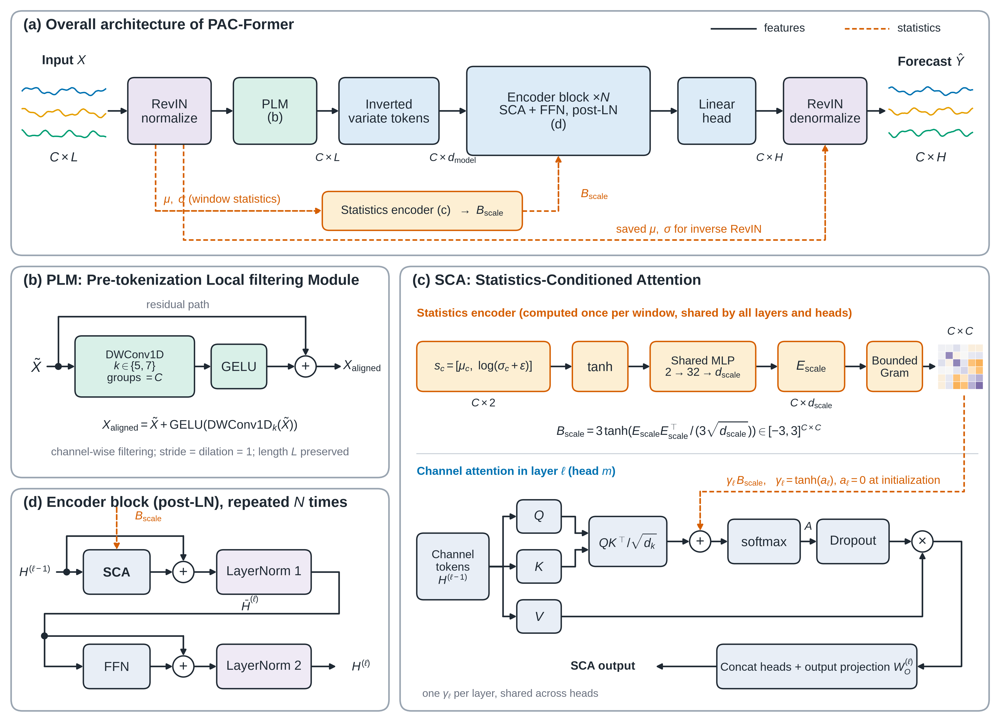

# PAC-Former

**PAC-Former: Statistics-Conditioned Channel Attention with Local Temporal Filtering for Multivariate Time Series Forecasting**

Official PyTorch implementation, configurations, logs and result files for the PAC-Former paper (manuscript under review).

<p align="center">
  
</p>

## Overview

PAC-Former (**P**re-filtered, **A**ffinity-**C**onditioned Trans**former**) is a variate-token forecaster built on reversible instance normalization (RevIN) and an inverted channel-token Transformer encoder, with two lightweight components:

- **PLM (Pre-tokenization Local filtering Module).** A residual depthwise `Conv1d` + GELU refines each channel's normalized history before inverted tokenization.
- **SCA (Statistics-Conditioned Attention).** The per-channel window mean and log standard deviation removed by RevIN are compressed with `tanh`, projected by a shared MLP, and turned into a bounded Gram affinity bias (`3·tanh(·/3)`) that is added to the channel-attention logits with a zero-initialized, per-layer coefficient `γ = tanh(a)`.

On seven benchmarks (L = 96, H ∈ {96, 192, 336, 720}) with validation-only model selection and a three-seed 2×2 factorial ablation, the complete model reduces the four-horizon mean MSE of the matched backbone by 5.74% on Weather and 4.22% on Electricity, with fewer than 0.67% additional parameters.

## Repository layout

```
.
├── pacformer/
│   ├── model.py          # RevIN, PLM, SCA, encoder, PACFormer, create_model (variants B/P/S/F)
│   └── training.py       # data protocol, warmup+cosine schedule, training/evaluation loops
├── configs/
│   ├── datasets.json     # dataset sources (pinned revisions), SHA-256, columns, splits, window counts
│   ├── search_space.json # 12-configuration grid (peak LR × d_model × kernel size)
│   ├── selected.json     # validation-selected configuration for each dataset/horizon
│   └── training.json     # fixed settings, optimizer, numerical flags, software versions
├── train.py              # search / main / ablation runs
├── evaluate.py           # evaluate released checkpoints on the test split
├── prepare_data.py       # download and checksum-verify the benchmark CSVs
├── summarize.py          # recompute results/ablation_summary.csv from results/runs.csv
├── plot_results.py       # redraw figures/ablation_{mse,mae}.{png,svg}
├── data/scalers/         # training-split StandardScaler parameters for each dataset
├── results/              # CSV result files (see "Results and logs")
├── logs/                 # per-epoch CSV logs for all search trials and final runs
├── figures/              # architecture figure, ablation, robustness, resource and training-curve plots
└── tests/                # unit test for shapes and variant initialization
```

## Installation

Tested with Python 3.11.7, PyTorch 2.5.1 (CUDA 12.1) on Ubuntu 22.04. Training and benchmark evaluation require an NVIDIA GPU; the code does not fall back to CPU.

```bash
git clone https://github.com/Veecky29/PAC-Former.git
cd PAC-Former
python -m venv .venv && source .venv/bin/activate   # Windows: .venv\Scripts\activate
python -m pip install -r requirements.txt --extra-index-url https://download.pytorch.org/whl/cu121
```

`requirements.txt` pins `torch==2.5.1+cu121`, `numpy==1.26.4`, `pandas==2.3.0`, `scikit-learn==1.7.0` and `matplotlib==3.9.4`.

## Data

The raw datasets are not redistributed in this repository. Download them from their original sources with:

```bash
python prepare_data.py
```

This fetches the seven CSV files into `data/benchmark/` and verifies each SHA-256 against `configs/datasets.json`:

| Dataset | Channels | Train / val / test steps | Source |
|---|---:|---|---|
| ETTh1, ETTh2 | 7 | 8,640 / 2,880 / 2,880 | [ETDataset](https://github.com/zhouhaoyi/ETDataset) @ `1d16c8f` |
| ETTm1, ETTm2 | 7 | 34,560 / 11,520 / 11,520 | [ETDataset](https://github.com/zhouhaoyi/ETDataset) @ `1d16c8f` |
| Weather | 21 | 36,887 / 5,270 / 10,539 | [THUML Time-Series-Library data](https://huggingface.co/datasets/thuml/Time-Series-Library) @ `2b66e59` |
| Electricity | 321 | 18,412 / 2,632 / 5,260 | [THUML Time-Series-Library data](https://huggingface.co/datasets/thuml/Time-Series-Library) @ `2b66e59` |
| Traffic | 862 | 12,280 / 1,756 / 3,508 | [THUML Time-Series-Library data](https://huggingface.co/datasets/thuml/Time-Series-Library) @ `2b66e59` |

If you already have the CSVs, place them in one folder named `ETTh1.csv`, `ETTh2.csv`, `ETTm1.csv`, `ETTm2.csv`, `Weather.csv`, `Electricity.csv`, `Traffic.csv` and run:

```bash
python prepare_data.py --source-dir /path/to/csv-files
```

The data remain under the terms of their original providers (ETDataset: CC BY-ND 4.0; the THUML Hugging Face archive: CC BY 4.0).

**Protocol.** StandardScaler is fitted on the training block only. Validation and test windows keep the preceding 96 observations as context, and every forecast target stays inside its own split. RevIN statistics use only the observed input window. MSE and MAE are computed after inverse RevIN in dataset-standardized coordinates, accumulated in float64 over every window, channel and step; the last incomplete evaluation batch is kept.

## Training settings

All settings below are recorded in `configs/training.json` and `configs/search_space.json`.

| Setting | Value |
|---|---|
| Lookback / horizons | L = 96; H ∈ {96, 192, 336, 720} |
| Optimizer | Adam, betas (0.9, 0.999), eps 1e-8, weight decay 0; MSE loss |
| Batch size | 32 (incomplete training batch dropped) |
| Epochs / early stopping | max 50, patience 5 on validation MSE |
| LR schedule | 1-epoch linear warmup from 0.1× to 1.0× peak, then per-step cosine decay to 0.01× peak at the end of epoch 50 |
| Search grid (12 configs) | peak LR ∈ {1e-4, 5e-4, 1e-3} × d_model ∈ {128, 256} × kernel k ∈ {5, 7} |
| Architecture | 2 post-LN encoder layers, 8 heads, d_ff = 2·d_model, dropout 0.1, d_scale = 16 (MLP hidden 32), RevIN affine = False |
| SCA | tanh-compressed [μ, log σ], bias bound ±3, per-layer γ = tanh(a), a initialized to 0 |
| Seeds | 2026 (search and main results); 2026, 2027, 2028 (robustness and ablation) |
| Numerics | float32, no AMP, no gradient clipping; deterministic algorithms; `matmul.allow_tf32 = False`, `cudnn.allow_tf32 = True` (PyTorch default); `CUBLAS_WORKSPACE_CONFIG=:4096:8` |
| Hardware used | 1× RTX 4090 (24 GB), 4 CPU threads per worker |

## Reproducing the experiments

```bash
# 1) Grid search (12 configs, seed 2026), select by validation MSE, then refit with seed 2026
python train.py --mode search --datasets Weather --horizons 96 --out outputs/search

# 2) Main results with the configurations in configs/selected.json (seed 2026)
python train.py --mode main --datasets Weather --horizons 96 --out outputs/main

# 3) 2x2 factorial ablation: B (backbone), P (PLM only), S (SCA only), F (complete), seeds 2026-2028
python train.py --mode ablation --datasets Weather --horizons 96 --out outputs/ablation
```

Omit `--datasets` / `--horizons` to run all seven datasets and four horizons. All four ablation variants use the configuration selected for F. Adding `--reuse-main PACFormer-models` to the ablation command reuses the released seed-2026 F checkpoints instead of retraining them. An interrupted run resumes from `last.pt` when restarted with the same `--out` directory.

## Pretrained checkpoints

The 28 complete-model checkpoints (seed 2026, one per dataset and horizon) are published as a release asset rather than committed to the repository:

1. Download `PACFormer-models.zip` from the [Releases page](https://github.com/Veecky29/PAC-Former/releases).
2. Extract it so that the files are at `PACFormer-models/checkpoints/<Dataset>/H<horizon>.pt` (the archive also contains `manifest.json` and `checksums.sha256`).
3. Evaluate:

```bash
python evaluate.py --models PACFormer-models --datasets Weather --horizons 96
python evaluate.py --models PACFormer-models            # all 28 checkpoints
```

`evaluate.py` recomputes test MSE/MAE and checks them against the metrics stored in each checkpoint. Results are written to `outputs/evaluation/metrics.csv`.

## Results

Complete model, L = 96. The seed-2026 columns are the main results reported in the paper; the three-seed columns use seeds 2026, 2027 and 2028 (sample SD, ddof = 1). Values are taken from `results/main_results.csv` and `results/robustness.csv`.

| Dataset | H | MSE (seed 2026) | MAE (seed 2026) | MSE, mean ± SD over 3 seeds | MAE, mean ± SD over 3 seeds |
|---|---:|---:|---:|---:|---:|
| ETTh1 | 96 | 0.388 | 0.404 | 0.399 ± 0.017 | 0.411 ± 0.009 |
| ETTh1 | 192 | 0.437 | 0.434 | 0.441 ± 0.008 | 0.436 ± 0.004 |
| ETTh1 | 336 | 0.483 | 0.457 | 0.487 ± 0.016 | 0.458 ± 0.006 |
| ETTh1 | 720 | 0.489 | 0.484 | 0.492 ± 0.007 | 0.485 ± 0.004 |
| ETTh2 | 96 | 0.305 | 0.353 | 0.304 ± 0.008 | 0.353 ± 0.003 |
| ETTh2 | 192 | 0.382 | 0.399 | 0.379 ± 0.005 | 0.400 ± 0.001 |
| ETTh2 | 336 | 0.425 | 0.433 | 0.423 ± 0.002 | 0.433 ± 0.001 |
| ETTh2 | 720 | 0.448 | 0.456 | 0.442 ± 0.006 | 0.454 ± 0.003 |
| ETTm1 | 96 | 0.327 | 0.364 | 0.331 ± 0.005 | 0.366 ± 0.004 |
| ETTm1 | 192 | 0.375 | 0.390 | 0.379 ± 0.004 | 0.392 ± 0.002 |
| ETTm1 | 336 | 0.432 | 0.422 | 0.422 ± 0.009 | 0.418 ± 0.004 |
| ETTm1 | 720 | 0.504 | 0.461 | 0.513 ± 0.013 | 0.464 ± 0.007 |
| ETTm2 | 96 | 0.179 | 0.263 | 0.181 ± 0.003 | 0.263 ± 0.002 |
| ETTm2 | 192 | 0.248 | 0.309 | 0.259 ± 0.016 | 0.315 ± 0.010 |
| ETTm2 | 336 | 0.322 | 0.355 | 0.317 ± 0.005 | 0.351 ± 0.003 |
| ETTm2 | 720 | 0.412 | 0.404 | 0.415 ± 0.003 | 0.407 ± 0.002 |
| Weather | 96 | 0.160 | 0.209 | 0.162 ± 0.002 | 0.210 ± 0.001 |
| Weather | 192 | 0.210 | 0.254 | 0.211 ± 0.004 | 0.254 ± 0.001 |
| Weather | 336 | 0.265 | 0.296 | 0.265 ± 0.001 | 0.297 ± 0.001 |
| Weather | 720 | 0.339 | 0.350 | 0.339 ± 0.001 | 0.348 ± 0.003 |
| Electricity | 96 | 0.138 | 0.234 | 0.139 ± 0.001 | 0.235 ± 0.001 |
| Electricity | 192 | 0.154 | 0.250 | 0.154 ± 0.000 | 0.250 ± 0.000 |
| Electricity | 336 | 0.175 | 0.275 | 0.173 ± 0.003 | 0.273 ± 0.004 |
| Electricity | 720 | 0.202 | 0.302 | 0.208 ± 0.009 | 0.306 ± 0.006 |
| Traffic | 96 | 0.404 | 0.270 | 0.407 ± 0.005 | 0.270 ± 0.001 |
| Traffic | 192 | 0.422 | 0.288 | 0.421 ± 0.009 | 0.285 ± 0.003 |
| Traffic | 336 | 0.444 | 0.294 | 0.448 ± 0.004 | 0.296 ± 0.007 |
| Traffic | 720 | 0.466 | 0.312 | 0.479 ± 0.011 | 0.314 ± 0.005 |

Published baseline numbers used for comparison in the paper are in `results/baselines.csv` (all from iTransformer, Table 10, L = 96).

## Results and logs

| File | Content |
|---|---|
| `results/search.csv` | 336 grid-search trials (7 datasets × 4 horizons × 12 configs) |
| `results/main_results.csv` | 28 seed-2026 complete-model results |
| `results/runs.csv` | 336 final runs (4 variants × 3 seeds × 28 settings) |
| `results/ablation_summary.csv` | mean and SD per dataset, horizon and variant |
| `results/robustness.csv` | complete-model seed-level scores with mean and SD |
| `results/paired_contrasts.csv` | P−B, S−B, F−P, F−S, F−B and interaction per seed |
| `results/dataset_averages.csv` | four-horizon averages per dataset and variant |
| `results/resources.csv` | parameters, epoch time, fit time and peak memory |
| `results/baselines.csv` | published baseline results with source |
| `logs/search/<Dataset>/H<h>/trial_XX.csv` | per-epoch logs of every search trial |
| `logs/final/<Dataset>/H<h>/<Variant>/seed_XXXX.csv` | per-epoch logs of every final run |

Logged training loss is the dropout-active online loss; validation loss is computed on all validation windows. Recompute the summary and redraw the ablation figure with:

```bash
python summarize.py
python plot_results.py
python -m unittest discover -s tests
```

## Citation

If you find this work useful, please cite:

```bibtex
@article{pacformer2026,
  title   = {{PAC-Former}: Statistics-Conditioned Channel Attention with Local Temporal Filtering for Multivariate Time Series Forecasting},
  author  = {Duan, Xinyao and Wang, Tianwen and Liu, Shimu and Mohammed, Okmi and Zhang, Xuzhuo and Por, Lip Yee},
  journal = {Under review},
  year    = {2026}
}
```

## Acknowledgements

We thank the maintainers of [ETDataset](https://github.com/zhouhaoyi/ETDataset), [Time-Series-Library](https://github.com/thuml/Time-Series-Library), [iTransformer](https://github.com/thuml/iTransformer) and [RevIN](https://github.com/ts-kim/RevIN).

## Contact

If you have any questions, please feel free to contact: (wangtianwen522@gmail.com), (23051789@siswa.um.edu.my).
